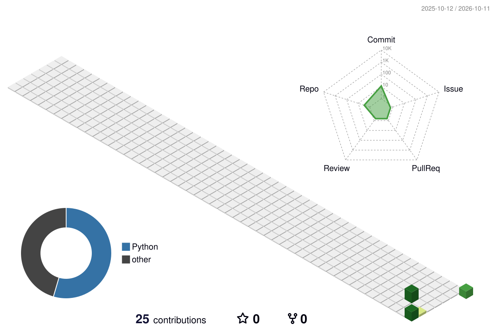

---

## Sobre mim

Engenheira Biomédica pela **UFU**, mestranda em Engenharia Biomédica pela **UFPE** e graduanda em Análise e Desenvolvimento de Sistemas pela **UFCA**. Sou pesquisadora no grupo de **Computação Biomédica da UFPE** e integro o **MONAN**, onde desenvolvo pesquisa em Inteligência Artificial aplicada ao Transtorno do Espectro Autista (TEA), com foco em processamento de sinais de EEG e aprendizado de máquina.

Na iniciação científica (bolsista CNPq) na **UFU**, construí e validei uma ferramenta em Python para processamento quantitativo de EEG em pacientes críticos de UTI, em colaboração direta com neurologistas do Hospital de Clínicas. No estágio em Engenharia Hospitalar na Divisão de Bioengenharia do **HC-UFU/Ebserh**, atuei da infraestrutura hospitalar ao desenvolvimento de software de gestão.

> [!NOTE]
> **Objetivo:** unir pesquisa e prática tecnológica em saúde, desenvolvendo e aplicando sistemas voltados ao cotidiano hospitalar.

**Áreas de interesse**

---

## Pesquisa

<b>IA e EEG para detecção precoce do TEA</b> — Mestrado · Computação Biomédica / MONAN · UFPE

 
Mapeamento topográfico de EEG combinado com **deep transfer learning** para apoiar a detecção precoce do Transtorno do Espectro Autista.
 
`EEG` `Deep Learning` `Transfer Learning` `Processamento de Sinais`
 

<b>EEG quantitativo em pacientes críticos</b> — Iniciação Científica CNPq · BioLab/UFU · 2021–2025

 
Desenvolvimento e validação de uma ferramenta em Python para processamento quantitativo de EEG de pacientes críticos em UTI, em colaboração com neurologistas do Hospital de Clínicas da UFU.
 
`Python` `EEG quantitativo` `UTI` `Validação clínica`
 

<b>Engenharia Hospitalar</b> — Estágio · Divisão de Bioengenharia · HC-UFU/Ebserh · 2024–2025

 
Apoio à infraestrutura hospitalar e ao desenvolvimento de software de gestão.
 
`Engenharia Clínica` `Software de Gestão`
 

---

## Publicações

---

## Tecnologias e ferramentas

**Pesquisa e dados**

**Desenvolvimento**

---

## Projetos em destaque

| Projeto | Área | Descrição |
|---|---|---|
| [teledengue](https://github.com/Arianne-Viana-Alves/teledengue) | `Telemedicina` | Aplicativo para monitoramento de sintomas da dengue |

---

## Estatísticas
 

  
 
<picture>
  <source media="(prefers-color-scheme: dark)" srcset="./profile-3d-contrib/profile-night-view.svg" />
  
</picture>

